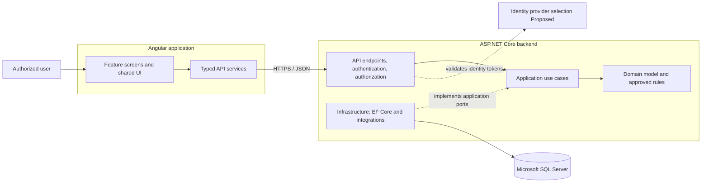
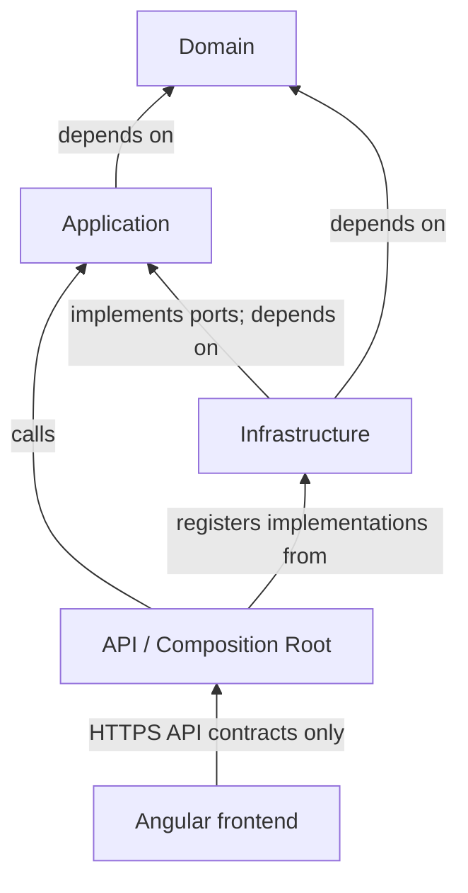

# Cargo Handling and Doorstep Collection Management System

## 1. Document Information and Approval Status

| Field | Value |
|---|---|
| Document | Solution Architecture |
| Project | Cargo Handling and Doorstep Collection Management System |
| Requirements baseline | [MVP Requirements](../requirements/mvp-requirements.md) |
| Document status | **Draft - Pending Technical Review** |
| Audience | Business stakeholders, architects, backend and frontend engineers, QA, and operations |
| Scope | Technical architecture for the MVP functional scope in the requirements baseline |

This document translates the MVP requirements into a proposed solution structure and technical approach. Business workflows, access rules, data fields, and measurable quality targets are governed by the requirements baseline; this document does not add new business functionality. Technical choices marked **Proposed** are recommendations for technical review and may be refined before implementation.

## 2. Solution Overview

The solution is a web-based cargo and doorstep collection management system with an Angular frontend, an ASP.NET Core Web API, and SQL Server persistence through Entity Framework Core (EF Core). The recommended initial architecture is a **modular monolith**: one backend deployment organized into Clean Architecture layers and business features, plus one Angular application.

The backend supports the requirement areas of identity and role-based access, collection request management, scheduling and assignment, collection attempts and outcomes, cargo registration and tracking, operational views, and audit history. Notifications are included only if their recipients, channels, content, and delivery behavior are approved for the MVP.

The design preserves distinctions that are important to the requirements:

- A scheduled or attempted collection is not, by itself, a successful handover or completed request.
- Cargo collection or registration does not imply cargo acceptance.
- An exception and its follow-up or resolution remain traceable rather than being overwritten.
- Failed persistence must be reported as failure, not as a successful change.

The system must enforce access on the server and preserve the actor and time for configured business and administrative changes. No route optimization, real-time vehicle tracking, billing, warehouse inventory management, offline-first operation, or other excluded functionality is included in this design.

## 3. Technology Stack

| Area | Technology | Status / use |
|---|---|---|
| Backend API | ASP.NET Core Web API | Approved stack; HTTP boundary and composition root |
| Frontend | Angular with TypeScript | Approved stack; browser user interface |
| Relational database | Microsoft SQL Server | Approved stack; persistent business and history records |
| ORM and migrations | Entity Framework Core | Approved stack; persistence implementation in Infrastructure |
| Architecture | Clean Architecture | Approved stack; dependency boundaries described below |
| CI/CD | GitHub Actions | Approved as a future CI/CD technology; pipeline scope and timing remain open |

Specific framework versions, hosting platform, authentication provider, UI component library, logging sink, deployment topology, and test libraries are **Open Technical Decisions**. Recommendations for these are marked **Proposed** in the relevant sections.

## 4. Clean Architecture Principles

The solution separates business behavior from delivery and persistence concerns:

1. **Domain independence:** business concepts and approved invariants do not depend on ASP.NET Core, Angular, EF Core, SQL Server, or an identity provider.
2. **Use-case-centered application:** Application coordinates business operations and defines the external capabilities it needs through abstractions.
3. **Infrastructure as an implementation detail:** database and other external-system implementations depend inward on Application and Domain contracts.
4. **Explicit boundaries:** API contracts, application models, domain entities, and database mappings have distinct purposes; persistence entities are not returned directly to clients.
5. **Feature cohesion:** request, collection, cargo, and operations behavior is grouped by business capability within each layer.
6. **Incremental scope:** only approved requirements are implemented. The architecture does not presume extra automation or integrations.

## 5. Logical Architecture Diagram (Mermaid)



The identity provider and its protocol are illustrative: selection and configuration remain **Proposed** pending the identity decision. The diagram represents logical responsibilities, not a required deployment topology.

## 6. Backend Solution Structure

**Proposed** solution and folder structure:

```text
CargoTracking.sln
src/
  CargoTracking.Api/
    Authorization/
    Configuration/
    Contracts/
    Endpoints/
    Middleware/
  CargoTracking.Application/
    Abstractions/
    Common/
    CollectionRequests/
    Scheduling/
    Collections/
    Cargo/
    Operations/
    Auditing/
  CargoTracking.Domain/
    CollectionRequests/
    Collections/
    Cargo/
    Shared/
  CargoTracking.Infrastructure/
    Identity/
    Integrations/
    Persistence/
      Configurations/
      Migrations/
tests/
  CargoTracking.Domain.Tests/
  CargoTracking.Application.Tests/
  CargoTracking.Api.IntegrationTests/
web/
  cargo-tracking-web/
    src/app/
      core/
      shared/
      features/
        collection-requests/
        scheduling/
        collections/
        cargo/
        operations/
```

Names and physical layout are **Proposed** and can be adjusted to repository conventions. Create test projects and feature areas to match the delivery plan; do not scaffold optional integrations or unapproved UI areas merely because a folder appears in this example.

## 7. Domain Layer Responsibilities

The Domain layer owns business language and behavior that can be derived from confirmed requirements. It should contain no database queries, HTTP concerns, framework attributes, or identity-provider types.

Candidate domain concepts, whose final shape depends on approved business definitions:

- **CollectionRequest** — the traceable request and its business lifecycle.
- **CollectionAttempt** — a recorded attempt and outcome; failure must not be represented as successful collection.
- **Schedule and Assignment** — planned collection details and assignment, modeled separately only where the approved lifecycle/history requires it.
- **Cargo** — a registered cargo record linked to its applicable request or another approved reference.
- **CargoEvent** — a recorded approved handling, custody, location, status, or exception event.
- **Disposition / AcceptanceDecision** — a distinct decision if business definitions separate cargo registration from acceptance.
- **Business exception** — a recorded exception with subsequent follow-up or resolution represented in retained history.

The Domain layer should enforce established invariants, such as not deriving a successful handover from an attempt alone. It must not invent status values, transition graphs, mandatory fields, reason codes, cargo cardinalities, or completion rules. Those are part of the approved business model, not architectural defaults.

Technical audit records and identity roles are not automatically Domain entities. Their ownership depends on the audit policy and identity design.

## 8. Application Layer Responsibilities

Application contains use cases, request/response models, orchestration, use-case validation, authorization context required by an operation, and ports for persistence or external capabilities. It does not depend on EF Core or ASP.NET Core.

Candidate use-case boundaries:

- Submit, review, find, and record permitted changes to a collection request.
- Record cancellation or rescheduling while preserving prior history.
- Record or revise approved planned collection details and assignment.
- Retrieve collection work assigned to the authenticated agent, subject to the approved access model.
- Record each collection attempt and its outcome with actor and time.
- Register cargo, link it to an applicable approved reference, and record a distinct disposition decision where required.
- Record approved cargo operational events; retrieve cargo and request event histories.
- Record exception follow-up or resolution as additional history.
- Retrieve approved operational queues and exception views using approved definitions and filters.
- Retrieve permitted audit history.
- Send notifications only when notification behavior is confirmed as an MVP requirement.

Each use case validates input, applies authorized business rules, coordinates the persistence operation, and reports failure if the change was not persisted. Application contracts should be specific to actual use cases; avoid generic abstractions with no current consumer.

## 9. Infrastructure Layer Responsibilities

Infrastructure implements technical capabilities required by Application:

- EF Core `DbContext`, entity configurations, SQL Server provider setup, and migrations.
- Persistence implementations for Application-defined query and command ports.
- Relational transactions and concurrency mechanisms where required by a business operation.
- Integration with the selected identity provider or notification service, if approved.
- Technical adapters for other confirmed external systems.

Infrastructure owns database-specific mappings and query optimizations. It must not become the home for business decision rules. Prefer EF Core’s native capabilities; do not add a generic repository or Unit of Work wrapper without a demonstrated requirement.

## 10. API Layer Responsibilities

The API is the HTTP delivery boundary and application composition root. It owns:

- HTTP endpoint routing, serialization, status codes, and request/response contracts.
- Authentication setup and enforcement of API authorization policies.
- Mapping between transport contracts and Application inputs/outputs.
- Central exception handling, validation response formatting, correlation identifiers, and OpenAPI documentation.
- Dependency injection registration for Application and Infrastructure.

API endpoints should call Application use cases rather than query `DbContext` directly. Responses must not expose internal exception details or persistence models. A change is reported as successful only after the corresponding use case confirms persistence.

**Proposed API conventions:** resource-oriented endpoints, consistent validation errors using Problem Details, standard HTTP semantics, and pagination/filter conventions for searches and operational views. Final contract fields and query options must follow approved workflow and data definitions.

**Proposed versioning:** begin with a stable `/api/v1` prefix if the API is independently consumed or released. Confirm the need before adding versioning packages or a more elaborate compatibility scheme.

## 11. Angular Frontend Architecture

Organize the Angular application by business capability:

- **Core:** app-wide routing, approved authentication integration, route guards, HTTP interceptors, and global configuration.
- **Shared:** reusable UI elements, pipes, directives, and utilities without business-specific ownership.
- **Features:** request handling, scheduling, collection execution, cargo, and operational views.

Feature areas own their routes, screens, feature-specific models, and typed API services. Shared UI should remain small and genuinely cross-feature. Use Angular route guards for navigation experience only; they do not replace API authorization.

The UI should make loading, empty, validation, denied, and save-failure states clear. It must not display an unpersisted update as successful. Forms and status labels should follow approved required fields and state definitions rather than encode assumptions. Do not add a full customer self-service portal, offline-first behavior, real-time tracking, or other excluded features.

## 12. Dependency Direction and Rules



| Component | May depend on | Must not depend on |
|---|---|---|
| Domain | BCL and its own domain types | Application, API, Infrastructure, EF Core, SQL Server, Angular, identity-provider SDKs |
| Application | Domain and application abstractions | API, Infrastructure implementations, EF Core, Angular |
| Infrastructure | Application abstractions, Domain, EF Core/provider SDKs | Angular; API presentation contracts |
| API | Application; Infrastructure for composition only | Domain persistence details or direct database operations |
| Angular | Public API contracts and frontend libraries | Backend assemblies, database schema, private persistence models |

Dependencies point inward toward policy. Infrastructure implements interfaces owned by the inner layers; dependency injection connects the implementation at runtime. Angular is a separate client and communicates only through the API.

## 13. Approved Functional Modules and Use Case Mapping

The modules below map the requirements baseline to technical responsibilities. Use cases are limited to the stated requirements; details such as specific fields, statuses, decision rights, and filters must follow the business definitions in that baseline.

| Requirements | Module | Candidate use cases | Main components |
|---|---|---|---|
| FR-001–005 | Collection request management | Submit request and return traceable reference; validate approved data; review and record an approved decision; record permitted changes, cancellation, or rescheduling with history; find requests using approved identifiers/filters | Application `CollectionRequests`; API request endpoints/contracts; Angular `collection-requests`; Domain request concepts |
| FR-006–007 | Scheduling and assignment | Record or revise planned collection details and assignment; retrieve an agent’s assigned work subject to approved access | Application `Scheduling`; API scheduling endpoints; Angular `scheduling` |
| FR-008–010 | Collection execution | Record each attempt and outcome, including unsuccessful attempts; record actor and time; distinguish failed attempt from successful handover | Application `Collections`; API attempt endpoints; Angular `collections`; Domain `CollectionAttempt` |
| FR-011–016 | Cargo registration and tracking | Register cargo; link to request or other approved reference; record separate acceptance/disposition where defined; record approved operational events; retrieve event history; enforce approved transition rules | Application `Cargo`; API cargo endpoints; Angular `cargo`; Domain cargo and event concepts |
| FR-017 | Notifications | Notify approved recipients about approved events only if notification delivery is confirmed for MVP | Application notification port and Infrastructure adapter only if approved |
| FR-018 | Audit history | Preserve configured significant request, cargo, assignment, and permission changes; expose history to authorized reviewers | Application `Auditing`; Infrastructure audit persistence; API audit access policy |
| FR-019 | Operational views | Retrieve approved work queues and exception views using business-approved statuses and filters | Application `Operations`; API query endpoints; Angular `operations` |
| FR-020 | Persistence failure feedback | Report failed save/update and do not present unpersisted data as successful | Application persistence outcome; API error mapping; Angular failure state |
| NFR-001–004, AC-009 | Identity and access | Authenticate users; authorize approved actions and data access; deny restricted operations without persistence | API authentication/authorization; approved identity integration; Angular sign-in/navigation experience |
| NFR-005–007, AC-011 | Auditability and integrity | Capture configured actor, timestamp, affected record, and change details; preserve history and consistent approved relationships | Application audit behavior; Infrastructure persistence; authorized history views |

## 14. Data Persistence Approach

SQL Server is the relational persistence store, and EF Core is the Infrastructure implementation. Application use cases should depend on purpose-specific ports where persistence access needs an abstraction; Infrastructure implements those ports. API and Domain should not use EF Core.

**Proposed persistence practices:**

- Map domain concepts explicitly using EF Core configurations rather than exposing database concerns on domain types.
- Use relational keys, constraints, and indexes to enforce confirmed identity and relationship rules.
- Use transactions around a single business operation where multiple writes must succeed or fail together.
- Add optimistic concurrency handling where conflicting updates are possible and the business has defined the expected outcome.
- Store operational history so original attempts, exceptions, schedule changes, and approved follow-up remain traceable.
- Treat EF Core migrations as reviewed deployment artifacts and validate schema changes against representative environments.

Identifier uniqueness, one-to-many or other cargo/request relationships, event retention, deletion, time-zone policy, data volume, and duplicate-submission behavior are **Open Technical Decisions** tied to business and operational answers. Do not infer these from the proposed entity names.

## 15. Authentication and Authorization Design

The API authenticates users and enforces authorization on every protected operation. The proposed user groups from the requirements—Customer/Requester, Dispatcher/Operations Coordinator, Collection Agent, Cargo Handling Operator, Operations Manager, and System Administrator—are the starting point for access-policy review, not a substitute for a detailed permission matrix.

**Proposed design:**

- Use an established identity provider and standards-based OIDC/OAuth authentication if one is available and approved. Do not build password management or an identity service by default.
- Define API policies around approved capabilities and enforce least privilege. Avoid scattering role-name string checks through domain behavior.
- Enforce record/resource-level access on queries and commands, including requester visibility and agent assignment scope. Never rely on Angular filtering to protect records.
- Deny access by default. Test both allowed and denied paths; a denied operation must not persist changes.
- Keep technical administration distinct from business configuration permissions.
- Validate token issuer, audience, signature, expiry, and required claims when using bearer tokens. If cookie-based authentication is chosen, design CSRF protection; in either case choose browser credential storage deliberately.
- Restrict CORS to approved origins, use HTTPS, protect secrets, and avoid logging credentials or unnecessary personal/cargo data.
- Audit configured administrative and permission changes and restrict access to audit records.

**Open Decisions:** identity provider and protocol; user provisioning; whether requesters are external, internal, or both; final role-to-permission matrix; record-level visibility; account recovery/MFA requirements; token and browser session strategy; and whether user administration is in MVP.

## 16. Logging, Auditing and Error Handling

### Logging

Use structured application logs with a correlation identifier so a request can be traced across API and infrastructure operations. Record operational failures and health-relevant events while minimizing sensitive payloads. Define access, retention, and redaction rules for logs; do not treat logs as a substitute for business audit history.

### Auditing

Persist significant business and administrative changes according to the audit policy, including actor, timestamp, affected record, and required change details. Distinguish:

- **Operational history:** request, assignment, attempt, cargo event, exception, and follow-up history needed by authorized users.
- **Audit history:** configured significant business/admin changes, including permission changes where policy requires.
- **Diagnostic logs:** technical activity used to investigate application behavior.

The system should retain original exception records and add later follow-up/resolution records rather than overwrite the original event. Audit detail, tamper-resistance, access, and retention are subject to the approved policy.

### Errors and validation

Validate transport shape at the API boundary and use-case requirements in Application. Enforce confirmed business invariants in Domain. Return consistent, actionable validation errors and map known authorization, not-found, and conflict cases to appropriate HTTP responses. Use a centralized exception boundary for unexpected failures, return a safe error response with correlation information, and log diagnostic detail without exposing internals to clients.

A persistence or downstream failure must be reported explicitly; do not return success or show the change as committed. Retry and reconciliation behavior must be defined for operations where duplicate or transient failure could affect business history.

## 17. Testing Strategy

| Test level | Focus |
|---|---|
| Domain unit tests | Confirmed business invariants, especially separation of attempt from successful handover and registration from acceptance when those are distinct |
| Application tests | Use-case outcomes, validation, authorization context, audit behavior, and explicit persistence-failure handling using test doubles for ports |
| API integration tests | HTTP contracts, authentication and authorization, validation/error mapping, and request-to-persistence behavior |
| Persistence tests | EF Core mappings, SQL Server constraints, migration compatibility, transactions, and concurrency behavior against a representative SQL Server test environment |
| Angular unit tests | Components, services, forms, route guards, loading/error states, and behavior on rejected or failed API calls |
| End-to-end tests | Approved high-value workflows across request, collection attempt, cargo, exception, and denied-operation paths |
| Quality/performance checks | Accessibility, supported browser/device matrix, load and response-time tests only against agreed criteria and conditions |

Tests should verify the approved requirement behavior, including AC-001–AC-012. AC-013 is measurable only after business and technical owners agree performance targets and test conditions. Do not encode unapproved state names, fields, or permission assumptions into permanent tests.

## 18. Configuration and Secrets Management

Keep environment-specific configuration outside source code and bind settings to typed options with startup validation for required values. Separate non-secret configuration from credentials and signing material. Provide local development configuration through documented, non-production means; use a managed secret store or deployment-provided secret mechanism in hosted environments.

Never commit secrets, private keys, connection passwords, or production credentials. Apply least privilege to database and service identities; rotate credentials according to the selected hosting and identity platforms. Avoid including secret values or sensitive personal/cargo details in configuration dumps and logs.

The precise configuration provider, local development approach, database credential mechanism, identity settings, and secret store are **Open Technical Decisions**.

## 19. Deployment Considerations

The modular monolith supports deployment as a single backend service and a separately served Angular application, with SQL Server as the persistence service. This is a logical recommendation, not a commitment to a particular cloud, hosting platform, topology, or availability tier.

Deployment should account for:

- Secure TLS termination and approved network boundaries between client, API, and database.
- Environment-specific configuration and secret injection.
- Controlled EF Core migration execution with review and rollback/recovery planning.
- Health and operational signals sufficient to investigate faults without leaking sensitive data.
- Backup, restore, availability, recovery objectives, retention, and ownership aligned with approved requirements.
- Supported browser/device accessibility and compatibility requirements once defined.
- Agreed deployment environments, release approvals, and operational support responsibilities.

GitHub Actions is the selected future CI/CD technology, but pipeline stages, triggers, environments, artifact handling, deployment automation, and release gates are not specified here and remain open. This architecture document does not imply that a pipeline has been implemented.

## 20. Architectural Decisions and Tradeoffs

| Decision | Rationale | Tradeoff |
|---|---|---|
| Modular monolith for the initial backend | Provides clear business boundaries without distributed-system overhead while scale and integration needs are not yet established | Modules share a deployable and database; boundaries must be maintained through code review and tests |
| Clean Architecture with Infrastructure implementing inner-layer ports | Keeps business use cases and rules independent of SQL Server and web frameworks | Requires explicit mapping and some interface/registration work |
| Separate request, attempt, cargo, and event concepts | Prevents the false implication that scheduling/attempt equals successful collection or registration equals acceptance | Exact object boundaries and lifecycle still require business confirmation |
| API contracts separate from domain and persistence types | Allows HTTP and schema evolution without leaking internals | Requires mapping and contract maintenance |
| Policy and resource-based authorization at API/use-case boundaries | Supports least privilege and record-level protections beyond coarse frontend navigation | Permission and visibility matrix must be defined and consistently tested |
| EF Core and SQL Server in Infrastructure | Uses the approved stack and supports relational consistency and transactions | Database-specific mappings and migrations need review; portability is not a primary goal |
| No event sourcing or microservices by default | Requirements call for traceable histories, not event-sourced storage or independent service deployment | If future scale or independent ownership justifies those patterns, a separate decision and migration would be needed |
| Notifications are conditional | FR-017 leaves recipients, channels, content, and delivery behavior to approval | Avoids introducing a delivery service or user-facing feature before scope is known |
| Versioning is a lightweight proposed convention | A version prefix can protect a separately consumed API contract | May be unnecessary overhead for a single internally released client; confirm consumer/release needs |

## 21. Open Technical Decisions

1. **Identity and access:** identity provider, protocol, provisioning, browser credential/session approach, MFA/account recovery needs, final permission matrix, and resource-level access rules.
2. **API contract lifecycle:** whether the API has consumers or releases independent of Angular, versioning convention, endpoint style, and pagination/filter limits.
3. **Data model details:** required request/cargo fields, identifier ownership and uniqueness, request-to-cargo cardinality, approved states/transitions, and concurrency/duplicate handling.
4. **Audit and retention:** audited change details, actor attribution, audit readership, tamper-resistance, log/audit retention, and personal-data deletion rules.
5. **Operational requirements:** expected usage/data volume, response-time and availability targets, backup/recovery objectives, time-zone behavior, and support ownership.
6. **Integrations and notifications:** authoritative external systems and whether notification delivery is in the MVP; if so, channels, recipients, content, retries, and failure visibility.
7. **Deployment and operations:** hosting platform, network topology, environments, secret-management service, database hosting, telemetry/log sink, and release/rollback practices.
8. **Frontend support:** supported browsers/devices, accessibility standard, localization needs, and any UI component/design system.
9. **Tooling choices:** target .NET and Angular versions, test frameworks, API endpoint style, and any logging/validation libraries, selected consistently with supported project versions.
10. **Repository conventions:** confirm solution and project naming conventions before scaffolding; the architecture layout names above are illustrative.

## 22. Phased Implementation Roadmap

1. **Confirm the implementation baseline** — Translate the requirements into an agreed field inventory, workflows and transitions, role/permission matrix, request/cargo relationship model, exception outcomes, audit rules, and measurable non-functional criteria. Resolve the open technical decisions that block the first slice.
2. **Establish the solution foundation** — Create the agreed backend projects and Angular application structure; set dependency rules, API conventions, configuration handling, database connectivity, and baseline unit/integration testing. Add no unapproved feature modules.
3. **Deliver request management** — Implement approved request submission and traceable reference, validation, review, search, and permitted request changes with retained history.
4. **Deliver scheduling and collection execution** — Implement approved scheduling and assignment recording, assigned-work access, and per-attempt outcomes; verify unsuccessful attempts are not represented as successful collections.
5. **Deliver cargo registration and operations history** — Implement approved cargo registration/linking, disposition where required, operational events, history, exceptions and their follow-up, and authorized operational views.
6. **Complete cross-cutting security and audit** — Apply the approved identity integration and authorization matrix, resource-level access checks, configured audit behavior, safe error handling, and privacy-conscious operational logging.
7. **Verify release readiness** — Run the agreed backend/frontend and end-to-end tests; validate migrations, denied access, persistence failures, and approved performance/accessibility/security criteria. Prepare deployment and future GitHub Actions pipeline decisions against the chosen hosting environment.

Each phase is gated by the business definitions it needs. Notifications, external integrations, and additional delivery capabilities enter implementation only when explicitly included in the approved MVP scope.
